# Phase 4: Queue Navigation & Live State Synchronization - Research

**Researched:** 2026-11-11  
**Domain:** SteamOS GamepadUI / Spotify Web API Player & Queue Synchronization / Decky Loader RPC  
**Confidence:** HIGH  

<user_constraints>
## User Constraints (from CONTEXT.md)

### Locked Decisions
- **D-01 (Explicit URIs Sequence Playback):** When the user selects track $N$ in the queue, start playback using an explicit sequence of that clicked track followed by all subsequent remaining queue tracks: `uris = queueTracks.slice(idx).map(x => x.uri)`. This guarantees Spotify immediately switches to the exact clicked track without offset mismatch, and retains the upcoming queue order.
  Also fix the backend RPC name binding: ensure `backendPlayTracks` in TypeScript correctly invokes `"play_tracks"`, and alias `play_track` to `play_tracks` in `main.py` for full bidirectional compatibility.
- **D-02 (Dedicated Now Playing Card & Visual Hierarchy):** Structure `QueueTab` with a dedicated, styled "Now Playing" card at the top (displaying album artwork via `DeckifyImage`, title, artist, duration, and green active indicator) followed by a "Next in Queue" header and a numbered scrollable list for upcoming tracks. If the queue is empty, maintain the Now Playing card and display a friendly empty state ("Queue is empty. Add songs from your library or search").
- **D-03 (Optimistic UI Update & 600ms Server Resync):** When a queue track is clicked, update the UI immediately without waiting for server responses: set the clicked track as the active 'Now Playing' item, remove all preceding tracks up to and including the clicked item from the local queue list, and trigger `refreshStatus()`. Schedule a delayed `get_queue` API refresh (600ms-800ms) to allow Spotify's backend queue pointer to settle before reconciling the canonical list.
- **D-04 (Gamepad Focus Preservation):** When a track in the queue is selected via GamepadUI (A button), retain controller focus within the queue list on the next available item (or fallback to the Now Playing card if the upcoming queue is now empty). Do not lose focus or cause spatial navigation to escape to the sidebar navigation tabs.
- **D-05 (Event-Driven Refresh with Conservative 10s Polling):** Refresh queue state immediately on tab switch (`mode === "queue"`) and after playback actions. While `QueueTab` remains actively open in the expanded modal, poll `get_queue` conservatively every 10 seconds to detect external track finishes or remote Spotify Connect changes without causing HTTP 429 rate limit backoffs.
- **D-06 (Track Actions & Capacity Cap):** Maintain interactive row actions in the queue (Like/Heart toggle `handleToggleLike`). Limit rendered upcoming queue items to 30-50 tracks to guarantee smooth 60fps controller scrolling in SteamOS GamepadUI.

### the agent's Discretion
- Exact styling details of the "Now Playing" header card in `QueueTab` to match existing Deckify card and typography themes.
- Exact debounce/delay constant (600ms vs 800ms) for background `get_queue` resynchronization.

### Deferred Ideas (OUT OF SCOPE)
- In-game HUD overlay window mounting and floating lyrics (deferred to Phase 5).
- Queue drag-and-drop reordering (Spotify Web API does not expose an arbitrary queue reordering endpoint; only append to queue).
- Offline lyrics caching (v2 requirement `LYRIC-01`).
</user_constraints>

<phase_requirements>
## Phase Requirements

| ID | Description | Research Support |
|----|-------------|------------------|
| QUEUE-01 | Fix track selection in the Queue view so clicking/selecting any queue item starts playback of that exact track. | Root cause analysis identified RPC binding mismatch (`"play_track"` vs `"play_tracks"`) and confirms explicit URI sequence array (`queueTracks.slice(idx).map(t => t.uri)`) starts target track reliably on Spotify Connect. |
| QUEUE-02 | Ensure selecting a queue track immediately updates the Now Playing view and re-synchronizes the upcoming queue list in real time. | Immediate optimistic local state update (promoting selected item to Now Playing, slicing queue array) paired with a 600ms debounced `get_queue` RPC call prevents visual stutter and resolves eventual consistency lag in Spotify's `me/player/queue` endpoint. |
</phase_requirements>

## Summary

Phase 4 restores functional track selection and live state synchronization to the Deckify Queue tab (`QueueTab.tsx`). Investigation of the existing codebase revealed two critical root causes behind queue playback failures:
1. **Decky RPC Endpoint Mismatch:** In [src/components/DeckifyExpandedModal.tsx:48](file:///C:/Users/djdje/Deckify/src/components/DeckifyExpandedModal.tsx#L48), `backendPlayTracks` was declared as `callable("play_track")`, whereas `Plugin` in [main.py:763-770](file:///C:/Users/djdje/Deckify/main.py#L763-L770) implements `play_tracks` (plural). Calls to `backendPlayTracks` resulted in unhandled RPC method dispatch failures.
2. **Missing Post-Play Queue Resynchronization & Visual Lag:** Slicing remaining tracks occurred only inside `QueueTab.tsx:35` as a transient parameter passed to `handlePlayTrack`, without updating modal-level `queueTracks` or `status` state. Furthermore, `loadQueue()` was never triggered after track selection.

To deliver an instant, responsive GamepadUI experience without HTTP 429 rate limit errors:
- We bind `backendPlayTracks` to `"play_tracks"` in TypeScript and alias `play_track = play_tracks` on `Plugin` in `main.py`.
- Playback of track $idx$ sends the sliced URI array `[queueTracks[idx].uri, ...queueTracks.slice(idx + 1).map(x => x.uri)]`.
- The modal performs an immediate optimistic UI update (setting Now Playing track and slicing the local queue) followed by a 600ms delayed server resync via `get_queue`.
- `QueueTab.tsx` is upgraded with a styled "Now Playing" card, "Next in Queue" header, numbered upcoming list (capped at 40 tracks), and controller focus preservation.

**Primary recommendation:** Fix RPC binding in `DeckifyExpandedModal.tsx` and `main.py`, execute explicit URI sequence playback with immediate optimistic state update, and debounce backend queue reconciliation by 600ms.

## Architectural Responsibility Map

| Capability | Primary Tier | Secondary Tier | Rationale |
|------------|-------------|----------------|-----------|
| Queue Track Slicing & URI Sequence | Browser / Client (`DeckifyExpandedModal.tsx`) | — | Client owns current list order and determines the explicit sequence of upcoming tracks from user selection. |
| Optimistic State Update | Browser / Client (`DeckifyExpandedModal.tsx`, `QueueTab.tsx`) | — | Instant visual feedback on Steam Deck requires immediate DOM update without waiting for roundtrip RPC or Spotify API latency. |
| Queue Resynchronization Scheduling | Browser / Client (`useCallback`, `setTimeout`) | API / Backend (`py_modules/rpc_playback.py`) | Client coordinates 600ms debounce to allow Spotify's distributed queue pointer to settle before re-fetching canonical state. |
| Spotify Playback Dispatch (`PUT /me/player/play`) | API / Backend (`py_modules/rpc_playback.py:play_tracks`) | External (Spotify Web API) | Backend signs OAuth bearer tokens, formats `{"uris": [...]}` JSON payload, and handles 404 auto-transfer fallbacks. |
| Queue Retrieval & Like Flag Enrichment | API / Backend (`py_modules/rpc_playback.py:get_queue`) | External (Spotify Web API) | Backend aggregates `GET me/player/queue` and batch-checks `me/tracks/contains` to enrich items with `is_liked` status. |
| Controller Spatial Navigation & Focus | Browser / Client (`@decky/ui` Focusable primitives) | — | Gamepad focus retention is strictly a client-side CEF DOM lifecycle concern. |

## Standard Stack

### Core
| Library | Version | Purpose | Why Standard |
|---------|---------|---------|--------------|
| React | 19.2.14 | Modal component hierarchy and reactive state management | Bundled with Decky Loader GamepadUI environment. |
| `@decky/ui` | 4.11.1 | Spatial controller navigation (`Focusable`), styling, and layout primitives | Official Valve/Decky UI library ensuring D-pad focus handling. |
| `@decky/api` | 1.1.3 | Typed RPC bridge between TypeScript frontend and Python backend (`callable`) | Standard IPC transport in Decky Loader. |
| Python `urllib` / `asyncio` | 3.11+ / 3.14 | Backend HTTP request execution and async scheduling | Standard library avoiding external runtime dependencies on SteamOS. |

### Supporting
| Library | Version | Purpose | When to Use |
|---------|---------|---------|-------------|
| `react-icons` (FaHeart, FaRegHeart, FaSpotify) | 5.5.0 | SVG iconography for like buttons and music indicators | In `QueueTab` row items and Now Playing status card. |
| `vitest` | 5.1.0 | Frontend unit and component testing | Verifying queue slicing logic, RPC invocation contracts, and component state. |
| Python `unittest` | 3.11+ / 3.14 | Backend opaque-box contract tests | Validating `play_tracks`, `play_track` alias, and `get_queue` formatting. |

### Alternatives Considered
| Instead of | Could Use | Tradeoff |
|------------|-----------|----------|
| Explicit URI Sequence (`uris: [t.uri, ...]`) | Queue Skip / Next API (`POST me/player/next`) | `next` requires executing $N$ sequential HTTP requests to skip ahead, causing latency, race conditions, and Spotify 429 rate limit errors. |
| Explicit URI Sequence (`uris: [t.uri, ...]`) | Spotify Queue Jump API | Spotify Web API does NOT expose an arbitrary queue seek or reorder endpoint; `PUT me/player/play` with `uris` is the official supported method. |
| 600ms Delayed Resync | Immediate `get_queue` Call | Immediate call fetches stale queue due to Spotify distributed backend replication delay (~300-500ms). |

## Package Legitimacy Audit

> All packages used in this phase are existing project dependencies. No new npm or PyPI packages are introduced.

| Package | Registry | Age | Downloads | Source Repo | Verdict | Disposition |
|---------|----------|-----|-----------|-------------|---------|-------------|
| `@decky/ui` | npm | 3+ yrs | Official Valve ecosystem | `github.com/SteamDeckHomebrew/decky-frontend-lib` | [OK] | Approved (existing) |
| `@decky/api` | npm | 3+ yrs | Official Valve ecosystem | `github.com/SteamDeckHomebrew/decky-frontend-lib` | [OK] | Approved (existing) |
| `react-icons` | npm | 7+ yrs | ~15M/wk | `github.com/react-icons/react-icons` | [OK] | Approved (existing) |
| `vitest` | npm | 4+ yrs | ~10M/wk | `github.com/vitest-dev/vitest` | [OK] | Approved (existing) |

**Packages removed due to [SLOP] verdict:** none  
**Packages flagged as suspicious [SUS]:** none  

## Architecture Patterns

### System Architecture Diagram

```mermaid
sequenceDiagram
    autonumber
    actor User as Steam Deck User (Gamepad)
    participant QT as QueueTab (UI)
    participant DM as DeckifyExpandedModal (State)
    participant RPC as Backend RPC (main.py / rpc_playback.py)
    participant SP as Spotify Web API (Remote)

    User->>QT: Select track N (Press A Button)
    QT->>DM: handlePlayQueueTrack(trackN, idx, remainingUris)
    
    rect rgb(20, 45, 20)
        Note over DM,QT: D-03: Immediate Optimistic Update
        DM->>DM: setStatus({ ...status, track: trackN, is_playing: true })
        DM->>DM: setQueueTracks(queueTracks.slice(idx + 1))
        DM->>QT: Re-render with trackN in Now Playing Card
        QT->>QT: D-04: Retain Gamepad focus on next upcoming item
    end

    DM->>RPC: backendPlayTracks(null, null, [trackN.uri, ...remaining], 0)
    RPC->>SP: PUT me/player/play {"uris": [trackN.uri, ...]}
    SP-->>RPC: 204 No Content
    RPC-->>DM: { ok: true }

    rect rgb(30, 30, 50)
        Note over DM,SP: D-03: Delayed Reconciliation (600ms)
        DM->>DM: Wait 600ms (settling delay)
        DM->>RPC: backendGetQueue()
        RPC->>SP: GET me/player/queue
        SP-->>RPC: { currently_playing: ..., queue: [...] }
        RPC-->>DM: { ok: true, currently_playing: ..., queue: [...] }
        DM->>DM: setQueueTracks(res.queue)
        DM->>DM: refreshStatus()
    end
```



### Component Architecture for QueueTab

`QueueTab.tsx` will be structured into three visual zones:
1. **Now Playing Card (Top):**
   - Styled container displaying current song artwork (via `DeckifyImage`, size 48x48, border radius 6px).
   - Track title (14px, font weight 700, white), artist name (12px, opacity 0.7).
   - Green active indicator badge (`#1db954` pill or dot with "NOW PLAYING" text).
   - Interactive Like toggle button (`FaHeart` / `FaRegHeart`).
   - Track duration label (`formatMs`).
2. **Next in Queue Section Header:**
   - Section title ("Next in Queue", 13px, font weight 700, uppercase letter spacing, opacity 0.6).
   - Track count indicator badge (e.g. `queueTracks.length`).
3. **Upcoming Track List:**
   - If `queueTracks.length === 0`: Friendly empty state message ("Queue is empty. Add songs from your library or search.").
   - If `queueTracks.length > 0`: `<Focusable flow-children="column">` rendering numbered items (`idx + 1`).
   - Each item is an `<InteractiveRow>` with artwork (32x32), title, artist, like button, duration, and gamepad focus handlers.
   - List rendered items capped at 40 tracks to preserve 60fps scrolling performance under GamepadUI CEF.

### Root Cause Analysis of Current Failures

#### 1. RPC Method Name Binding Mismatch
- **Source of truth:** [src/components/DeckifyExpandedModal.tsx:48](file:///C:/Users/djdje/Deckify/src/components/DeckifyExpandedModal.tsx#L48) `[VERIFIED: src/components/DeckifyExpandedModal.tsx:48]`
  Verbatim quote:
  ```typescript
  const backendPlayTracks = callable<[string | null, string | null, string[] | null, number], { ok: boolean; error?: string }>("play_track");
  ```
- **Backend registration:** [main.py:763-770](file:///C:/Users/djdje/Deckify/main.py#L763-L770) `[VERIFIED: main.py:763-770]`
  Verbatim quote:
  ```python
      async def play_tracks(
          self,
          context_uri: str | None = None,
          offset_uri: str | None = None,
          uris: list | None = None,
          position: int = 0,
      ) -> dict:
          return await rpc_playback.play_tracks(self, context_uri, offset_uri, uris, position)
  ```
- **Finding:** The TypeScript frontend calls `"play_track"` (singular), but Python `Plugin` exposes `"play_tracks"` (plural). Calling `backendPlayTracks` fails at runtime with RPC method not found.
- **Fix:** Update `callable(...)` in TypeScript to `"play_tracks"`, AND add `play_track = play_tracks` on `Plugin` in `main.py` for two-way resilience.

#### 2. Disconnected Slicing & Lack of Local State Mutation
- **Source of truth:** [src/components/tabs/QueueTab.tsx:33-38](file:///C:/Users/djdje/Deckify/src/components/tabs/QueueTab.tsx#L33-L38) `[VERIFIED: src/components/tabs/QueueTab.tsx:33-38]`
  Verbatim quote:
  ```typescript
                onClick={() => {
                  if (t.uri) {
                    const remaining = queueTracks.slice(idx).map((x) => x.uri).filter(Boolean) as string[];
                    handlePlayTrack(t.uri, undefined, remaining, 0);
                  }
                }}
  ```
- **Source of truth:** [src/components/DeckifyExpandedModal.tsx:386-396](file:///C:/Users/djdje/Deckify/src/components/DeckifyExpandedModal.tsx#L386-L396) `[VERIFIED: src/components/DeckifyExpandedModal.tsx:386-396]`
  Verbatim quote:
  ```typescript
    const handlePlayTrack = useCallback(async (uri: string, contextUri?: string, allUris?: string[], startIdx?: number) => {
      if (contextUri) {
        await backendPlayTracks(contextUri, uri || null, null, 0);
      } else if (allUris && allUris.length > 0) {
        await backendPlayTracks(null, null, allUris, startIdx ?? 0);
      } else {
        await backendPlayTracks(null, uri || null, null, 0);
      }
      showToast("Playback started");
      refreshStatus();
    }, [showToast, refreshStatus]);
  ```
- **Finding:** When a track was clicked, `handlePlayTrack` only triggered `refreshStatus()`. It never mutated `queueTracks`, never called `loadQueue()`, and never optimistically updated `status.track`. The clicked track remained visible at index $idx$ in the UI, giving the impression that clicking failed.
- **Fix:** Implement dedicated `handlePlayQueueTrack` that optimistically mutates local state, promotes track $idx$ to Now Playing, slices remaining tracks, and schedules a 600ms delayed `loadQueue()`.

#### 3. Spotify Eventual Consistency Lag
- **Source of truth:** [py_modules/rpc_playback.py:287-290](file:///C:/Users/djdje/Deckify/py_modules/rpc_playback.py#L287-L290) `[VERIFIED: py_modules/rpc_playback.py:287-290]`
  Verbatim quote:
  ```python
          return {
              "ok": True,
              "currently_playing": curr,
              "queue": queue_items,
          }
  ```
- **Finding:** Spotify's `me/player/queue` endpoint updates asynchronously relative to `me/player/play`. Immediate polling after playback start returns the prior queue state. A 600ms debounce ensures Spotify's queue cursor has advanced before re-fetching.

### Recommended Project Structure
```
src/
├── components/
│   ├── tabs/
│   │   ├── QueueTab.tsx          # Upgraded: Now Playing card + Next in Queue + numbered list + focus retention
│   │   └── QueueTab.test.tsx     # Vitest component & interaction tests
│   └── DeckifyExpandedModal.tsx  # Upgraded: backendPlayTracks binding, handlePlayQueueTrack optimistic update, 10s poll
py_modules/
├── rpc_playback.py               # play_tracks & get_queue handlers
main.py                           # Plugin entrypoint: play_track = play_tracks alias
tests/
├── test_plugin_api.py            # Unit test for play_track alias and play_tracks invocation
└── test_e2e_requirements.py      # E2E assertions for queue playback contracts
```

### Pattern 1: Explicit URIs Queue Playback
**What:** Pass an ordered sequence of track URIs starting with the selected track to `PUT me/player/play`.  
**When to use:** When playing from an arbitrary user queue list where context URI is null.  
**Example:**
```typescript
// Source: Spotify Web API PUT /v1/me/player/play specification
const uris = queueTracks.slice(idx).map((x) => x.uri).filter(Boolean) as string[];
await backendPlayTracks(null, null, uris, 0);
```

### Pattern 2: Optimistic UI with Settling Resync
**What:** Mutate local React state synchronously on user click, followed by a delayed network resynchronization.  
**When to use:** In music playback controls where network and remote engine lag causes visible UI stutter.  
**Example:**
```typescript
const handlePlayQueueTrack = useCallback(async (clickedTrack: TrackItem, idx: number) => {
  // 1. Immediate optimistic UI update
  const remaining = queueTracks.slice(idx + 1);
  setQueueTracks(remaining);
  if (status) {
    setStatus({
      ...status,
      track: {
        ...status.track,
        name: clickedTrack.name || "",
        artist: clickedTrack.artist || "",
        album: clickedTrack.album || "",
        artwork_url: clickedTrack.artwork_url || clickedTrack.image_url,
        image_url: clickedTrack.artwork_url || clickedTrack.image_url,
        duration_ms: clickedTrack.duration_ms || 0,
        uri: clickedTrack.uri,
        track_id: clickedTrack.id || clickedTrack.track_id,
        id: clickedTrack.id || clickedTrack.track_id,
        is_liked: clickedTrack.is_liked,
      },
      is_playing: true,
    });
  }
  
  // 2. Playback RPC call
  const uris = queueTracks.slice(idx).map((x) => x.uri).filter(Boolean) as string[];
  await backendPlayTracks(null, null, uris, 0);
  showToast("Playback started");
  refreshStatus();

  // 3. Delayed canonical resync after Spotify settles
  setTimeout(async () => {
    await loadQueue();
    await refreshStatus();
  }, 600);
}, [queueTracks, status, showToast, refreshStatus, loadQueue]);
```

### Pattern 3: Focus Preservation in Sliced Lists
**What:** Maintain spatial focus on the upcoming queue list even when the clicked item is sliced from the DOM.  
**When to use:** Inside SteamOS GamepadUI where unmounting the currently focused DOM node can cause navigation to escape to the sidebar.  
**Example:**
```typescript
// InteractiveRow maintains focus within container
<Focusable flow-children="column" style={{ display: "flex", flexDirection: "column", gap: 3 }}>
  {queueTracks.map((t, idx) => (
    <InteractiveRow
      key={t.id || t.uri || idx}
      onClick={() => handlePlayQueueTrack(t, idx)}
      onFocus={() => onFocusTrack?.(t)}
    >
      {/* Track item details */}
    </InteractiveRow>
  ))}
</Focusable>
```

### Anti-Patterns to Avoid
- **Calling `me/player/next` in a loop to skip queue items:** High network overhead, triggers rate limit HTTP 429, and creates audible stutter as tracks briefly start and skip.
- **Re-fetching `get_queue` immediately after `play_tracks`:** Returns stale queue state from Spotify's cached edge.
- **Removing Now Playing card when queue is empty:** Breaks visual hierarchy and disorients gamepad navigation; maintain the card and display a centered message for the upcoming list.

## Don't Hand-Roll

| Problem | Don't Build | Use Instead | Why |
|---------|-------------|-------------|-----|
| Gamepad spatial focus | Custom keyboard/gamepad event router | `@decky/ui` `<Focusable flow-children="column">` | Valve's spatial navigation handles D-pad navigation, boundaries, and modal scoping automatically. |
| Time formatting | Custom regex/string manipulation | `formatMs` helper from `InteractiveRow.tsx` | Handles negative timestamps, sub-minute padding, and millisecond conversions correctly. |
| Base64 image proxying | Direct `fetch()` to `https://i.scdn.co/` | `<DeckifyImage>` proxy component | Steam CEF Content Security Policy blocks direct external image loading; `DeckifyImage` proxies through backend cache. |

## Common Pitfalls

### Pitfall 1: Calling `"play_track"` instead of `"play_tracks"`
**What goes wrong:** Calling `callable("play_track")` returns `{ ok: false, error: "Method not found" }`.  
**Why it happens:** The Python method is named `play_tracks` (plural).  
**How to avoid:** Correct the frontend binding to `"play_tracks"` AND add `play_track = play_tracks` alias in `main.py`.  
**Warning signs:** Playback never starts when clicking queue tracks, but logs show no Python exceptions.

### Pitfall 2: Focus Loss to Sidebar on DOM Unmount
**What goes wrong:** Pressing A on queue item $N$ causes focus to jump to the Left Sidebar navigation tabs.  
**Why it happens:** When track $N$ is removed from the DOM list by the slice operation, CEF spatial navigation loses its active target and falls back to the parent container's first focusable sibling (the sidebar).  
**How to avoid:** Ensure the upcoming list container and rows have stable keying (`t.id || t.uri || idx`). Because track $N+1$ now occupies the position under the cursor, spatial navigation automatically re-anchors to the new element at that location, provided the container maintains `flow-children="column"`.

### Pitfall 3: Rate Limiting (HTTP 429) from Aggressive Polling
**What goes wrong:** Modal freezes or returns Spotify API 429 errors.  
**Why it happens:** Polling `get_queue` every 1-2 seconds exceeds Spotify Web API limits.  
**How to avoid:** Event-driven updates on tab entry/action + 10s conservative polling while `QueueTab` is active.

## Code Examples

### 1. Backend RPC Alias in `main.py`
```python
# In class Plugin (main.py)
async def play_tracks(
    self,
    context_uri: str | None = None,
    offset_uri: str | None = None,
    uris: list | None = None,
    position: int = 0,
) -> dict:
    return await rpc_playback.play_tracks(self, context_uri, offset_uri, uris, position)

# Bidirectional compatibility alias [D-01]
play_track = play_tracks
```

### 2. Frontend RPC Callable Binding in `DeckifyExpandedModal.tsx`
```typescript
// In DeckifyExpandedModal.tsx:48
const backendPlayTracks = callable<
  [string | null, string | null, string[] | null, number],
  { ok: boolean; error?: string }
>("play_tracks");
```

### 3. Queue Tab Component Structure (`QueueTab.tsx`)
```tsx
export interface QueueTabProps {
  queueTracks: TrackItem[];
  currentlyPlaying?: TrackItem | TrackMeta | null;
  isPlaying?: boolean;
  handlePlayTrack: (uri: string, contextUri?: string, allUris?: string[], startIdx?: number) => void;
  handlePlayQueueTrack?: (clickedTrack: TrackItem, idx: number) => void;
  handleToggleLike: (trackId?: string) => void;
  onFocusTrack?: (track: TrackItem) => void;
}

export const QueueTab: FC<QueueTabProps> = ({
  queueTracks,
  currentlyPlaying,
  isPlaying = false,
  handlePlayTrack,
  handlePlayQueueTrack,
  handleToggleLike,
  onFocusTrack,
}) => {
  // Render Now Playing Card + Next in Queue header + numbered upcoming list capped at 40
  // ...
};
```

## State of the Art

| Old Approach | Current Approach | When Changed | Impact |
|--------------|------------------|--------------|--------|
| Frontend calls `backendPlayTracks("play_track")` | Frontend calls `"play_tracks"` + backend alias `play_track = play_tracks` | Phase 4 | Eliminates RPC dispatch failure and ensures full backward/forward compatibility. |
| Calling `handlePlayTrack` without optimistic state update | Immediate optimistic queue slice and Now Playing promotion + 600ms delayed resync | Phase 4 | UI reflects new track instantly; eliminates visual lag and prevents desync. |
| Plain unnumbered list without Now Playing header | Dedicated Now Playing card + Next in Queue header + numbered rows | Phase 4 | Matches Spotify Desktop and GamepadUI visual hierarchy; retains focus when queue clears. |

## Assumptions Log

| # | Claim | Section | Risk if Wrong |
|---|-------|---------|---------------|
| A1 | Spotify's distributed queue cursor settles within 600ms of `me/player/play` completion. | Architecture Patterns / D-03 | Very low; 600ms is well above the typical 200-400ms Spotify Connect sync window. If delayed, subsequent 10s poll reconciles state. |

## Open Questions (RESOLVED)

1. **Should the Now Playing card in `QueueTab` be interactive (clickable to navigate to `NowPlayingTab`)?** — RESOLVED: The Now Playing card renders styled track info with a visible playing indicator and like toggle per D-02; clicks do not trigger tab navigation to avoid unexpected focus escapes, keeping the user in the Queue tab.

## Environment Availability

| Dependency | Required By | Available | Version | Fallback |
|------------|------------|-----------|---------|----------|
| Node.js | Development & Vitest | ✓ | 25.1.0 | — |
| Python | Backend tests & Decky daemon | ✓ | 3.14.0 | — |
| Vitest | Frontend unit tests | ✓ | 5.1.0 | — |
| pnpm | Package management | ✓ | 9.x | npm |

**Missing dependencies with no fallback:** None.  
**Missing dependencies with fallback:** None.  

## Validation Architecture

### Test Framework
| Property | Value |
|----------|-------|
| Framework | Vitest 5.1.0 (Frontend) / Python `unittest` (Backend) |
| Config file | `package.json` test scripts (`pnpm test`, `test:python`) |
| Quick run command | `npx vitest run src/components/tabs/QueueTab.test.tsx` |
| Full suite command | `npx vitest run && & "C:\Users\djdje\AppData\Local\Python\bin\python.exe" -m unittest discover tests` |

### Phase Requirements → Test Map
| Req ID | Behavior | Test Type | Automated Command | File Exists? |
|--------|----------|-----------|-------------------|-------------|
| QUEUE-01 | Selecting queue track $N$ passes sliced URI sequence to `play_tracks` | unit (Vitest) | `npx vitest run src/components/tabs/QueueTab.test.tsx` | ❌ Wave 0 Gap |
| QUEUE-01 | Backend `play_track` is aliased to `play_tracks` and dispatches `me/player/play` with `uris` | unit (Python) | `& "C:\Users\djdje\AppData\Local\Python\bin\python.exe" -m unittest tests.test_plugin_api` | ✅ `tests/test_plugin_api.py` |
| QUEUE-01 | E2E opaque-box contract confirms Queue track items have play click binding | e2e (Python) | `& "C:\Users\djdje\AppData\Local\Python\bin\python.exe" -m unittest tests.test_e2e_requirements.TestTier1FeatureCoverage.test_r9_queue_items_have_click_to_play_binding` | ✅ `tests/test_e2e_requirements.py` |
| QUEUE-02 | Selecting a queue track optimistically updates Now Playing and slices upcoming queue | unit (Vitest) | `npx vitest run src/components/tabs/QueueTab.test.tsx` | ❌ Wave 0 Gap |
| QUEUE-02 | `QueueTab` renders Now Playing card, "Next in Queue" header, and numbered rows | unit (Vitest) | `npx vitest run src/components/tabs/QueueTab.test.tsx` | ❌ Wave 0 Gap |

### Sampling Rate
- **Per task commit:** `npx vitest run src/components/tabs/QueueTab.test.tsx` and quick Python test
- **Per wave merge:** Full suite green (`npx vitest run && python -m unittest discover tests`)
- **Phase gate:** Full suite green before `/gsd-verify-work`

### Wave 0 Gaps
- [ ] `src/components/tabs/QueueTab.test.tsx` — covers QUEUE-01 and QUEUE-02 component rendering, click slicing, like toggle, and empty state.
- [ ] Add `test_play_track_alias` in `tests/test_plugin_api.py` — verifies `plugin.play_track == plugin.play_tracks` and behaves identically.

## Security Domain

### Applicable ASVS Categories

| ASVS Category | Applies | Standard Control |
|---------------|---------|-----------------|
| V2 Authentication | yes | OAuth Bearer token lifecycle managed via `_ensure_token` and PKCE. |
| V4 Access Control | yes | Spotify user scope verification (`user-read-playback-state`, `user-modify-playback-state`). |
| V5 Input Validation | yes | Sanitize and filter track URIs (`spotify:track:...`) to prevent malformed API bodies. |
| V6 Cryptography | yes | TLS 1.3 for all outbound Spotify Web API HTTPS requests. |

### Known Threat Patterns for Spotify Queue & Playback

| Pattern | STRIDE | Standard Mitigation |
|---------|--------|---------------------|
| Injection of malformed URIs | Tampering | URI validation in `play_tracks`: verify string format starts with `spotify:track:` or valid Spotify URI pattern. |
| Token exposure in logs | Information Disclosure | Omit authorization headers and tokens from `decky.logger` debug statements. |
| API Rate Limiting Denial of Service | Denial of Service | Enforce 10s polling interval and debounce `get_queue` calls to prevent HTTP 429 penalties. |

## Sources

### Primary (HIGH confidence)
- In-repo source inspection:
  - `src/components/DeckifyExpandedModal.tsx:48` `[VERIFIED: src/components/DeckifyExpandedModal.tsx:48]`
  - `main.py:763-770` `[VERIFIED: main.py:763-770]`
  - `py_modules/rpc_playback.py:239-367` `[VERIFIED: py_modules/rpc_playback.py:239-367]`
  - `src/components/tabs/QueueTab.tsx:1-71` `[VERIFIED: src/components/tabs/QueueTab.tsx:1-71]`
  - `src/types.ts:51-64` `[VERIFIED: src/types.ts:51-64]`
  - `tests/test_e2e_requirements.py:575-621` `[VERIFIED: tests/test_e2e_requirements.py:575-621]`
- Spotify Web API Official Documentation: `https://developer.spotify.com/documentation/web-api/reference/start-a-users-playback` `[CITED: developer.spotify.com/documentation/web-api/reference/start-a-users-playback]`
- Spotify Web API Official Documentation: `https://developer.spotify.com/documentation/web-api/reference/get-queue` `[CITED: developer.spotify.com/documentation/web-api/reference/get-queue]`

### Secondary (MEDIUM confidence)
- SteamDeckHomebrew Decky Loader documentation on spatial navigation & `@decky/ui` Focusable primitives.

## Metadata

**Confidence breakdown:**
- Standard stack: HIGH - Verified in project package.json and working environment.
- Architecture: HIGH - Fully aligned with existing codebase conventions and CONTEXT.md decisions.
- Pitfalls: HIGH - Root causes directly pinpointed in lines of code this session.

**Research date:** 2026-11-11  
**Valid until:** 2026-12-31 (Stable architecture within milestone)
