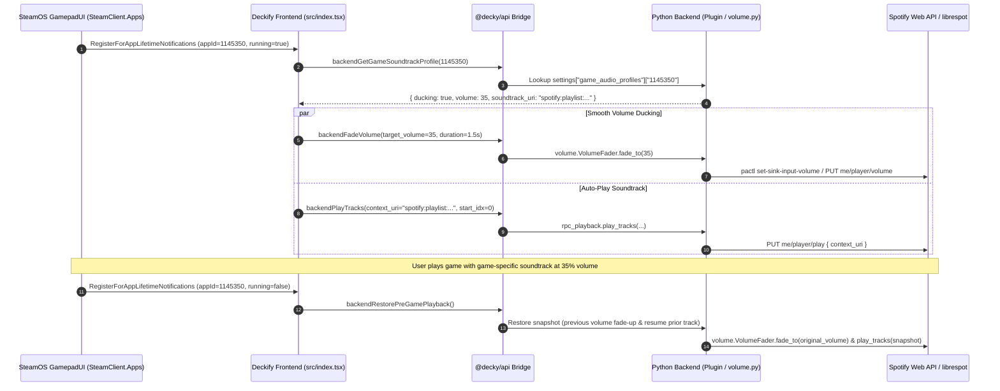

# Architecture Patterns: Milestone v0.5 (In-Game Flow & Music Discovery)

**Domain:** SteamOS Decky Loader Plugin / Embedded Spotify Client  
**Researched:** 2026-11-12  
**Target Milestone:** v0.5 — In-Game Flow & Music Discovery  
**Overall Confidence:** HIGH (Verified against v0.4 codebase, SteamOS CEF runtime, and Decky Loader 4.x APIs)

---

## Executive Architectural Summary

Milestone v0.5 elevates Deckify from a static controller-accessible Spotify client into a deeply integrated SteamOS companion that adapts to gameplay in real time. It introduces 6 core capabilities:
1. **Game-Specific Soundtracks**: Binding Spotify playlists/albums to Steam game `appId`s with auto-play on launch and restore on exit.
2. **Smooth Ducking Engine**: Non-blocking Python `asyncio` volume fader gradually reducing game audio over ~1.5s rather than abrupt cuts.
3. **Quick Access Menu (QAM) Pinned Playlists**: Direct 3-4 pinned playlist buttons in the mini-player for sub-2-second mid-game switching.
4. **L2/R2 Controller Triggers**: Blind +/-10s seeking and fast list paging without losing track focus or navigating to the seekbar.
5. **In-Game Overlay 2.0 (Live Lyrics Line)**: Low-latency active synced lyrics HUD mounted inside Gamescope.
6. **Home / Made For You Discovery Tab**: Personalized Spotify discovery hub (Discover Weekly, Release Radar, Top Tracks) in the Expanded Modal.

All 6 features integrate directly into the decoupled v0.4 architecture (`src/components/tabs/` on frontend, `py_modules/` on backend, and `@decky/api` RPC bridges) without compromising thread safety, gamescope frame times, or Steam CEF Content Security Policy restrictions.

---

## System Architecture Diagram

```
+---------------------------------------------------------------------------------------+
|                                SteamOS GamepadUI (CEF)                                |
|                                                                                       |
|  +---------------------------+  +-------------------------------+  +---------------+  |
|  |     Gamescope Overlay     |  |    Quick Access Menu (QAM)    |  | Expanded Modal|  |
|  |  +---------------------+  |  |  +-------------------------+  |  | +-----------+ |  |
|  |  | DeckifyOverlay (HUD)|  |  |  | Mini-Player & Pinned    |  |  | | Discovery | |  |
|  |  | - Song / Artist     |  |  |  | Playlists (3-4 pills)   |  |  | | Tab (NEW) | |  |
|  |  | - Live Lyrics Line  |  |  |  +-------------------------+  |  | +-----------+ |  |
|  |  | - 2px Progress Bar  |  |  +-------------------------------+  | | L2/R2     | |  |
|  |  +---------------------+  |                                     | | Triggers  | |  |
|  +-------------^-------------+                                     | +-----------+ |  |
|                | (Active Line)                                     +-------^-------+  |
|  +-------------+-------------+                                             |          |
|  |   DeckifyOverlayWrapper   |                                             |          |
|  |   - 200ms Synced Ticker   |                                             |          |
|  |   - SteamClient Hooks     |                                             |          |
|  +-------------+-------------+                                             |          |
+----------------|-----------------------------------------------------------|----------+
                 | @decky/api callable RPCs                                  |
                 v                                                           v
+---------------------------------------------------------------------------------------+
|                                Python Backend Daemon                                  |
|                                                                                       |
|  +-----------------------+  +---------------------------+  +-----------------------+  |
|  |    py_modules/volume  |  |   py_modules/rpc_playback |  | py_modules/rpc_library|  |
|  |  - Async Volume Fader |  |  - Snapshot & Restore     |  | - Discovery Feeds     |  |
|  |  - Pactl / PipeWire   |  |  - Auto-play Game Tracks  |  | - Pinned Playlists    |  |
|  +-----------------------+  +---------------------------+  +-----------------------+  |
|                                                                                       |
|  +-----------------------+  +---------------------------+  +-----------------------+  |
|  |   py_modules/common   |  |    py_modules/spotify     |  |   py_modules/images   |  |
|  |  - settings.json      |  |  - LRCLIB & Spotify Lyrics|  |  - Base64 CSP Proxy   |  |
|  |  - Game Profile Schema|  |  - Top Tracks / Discovery |  |  - Throttled Queue    |  |
|  +-----------------------+  +---------------------------+  +-----------------------+  |
+---------------------------------------------------------------------------------------+
```

---

## Component Boundaries: New vs Modified

| Component | Status | Responsibility | Integration Touchpoints |
|-----------|--------|----------------|--------------------------|
| `py_modules/volume.py` | **Modified** | Houses smooth `asyncio` volume fader task (`fade_volume`); cancels conflicting fades; drives PipeWire/PulseAudio sink-input volume. | `Plugin.fade_volume` RPC, called by `src/index.tsx` on game launch/exit. |
| `src/index.tsx` (`Content`) | **Modified** | Renders 3-4 pinned playlist buttons in QAM with direct context play; handles QAM state sync. | `settings.pinned_playlists`, `backendPlayTracks`, `flow-children="horizontal"`. |
| `src/index.tsx` (AppLifetime) | **Modified** | Hooks `SteamClient.Apps.RegisterForAppLifetimeNotifications`; detects game launch/exit; invokes auto-ducking fade and game soundtrack auto-play. | `backendFadeVolume`, `backendPlayGameSoundtrack`, `backendRestorePlayback`. |
| `src/index.tsx` (`DeckifyOverlayWrapper`) | **Modified** | Manages overlay lifecycle, fetches cached lyrics on track change, ticks active lyrics line at 200ms intervals, passes `activeLyricsLine` to `DeckifyOverlay`. | `DeckifyOverlay`, `backendGetLyrics`, `usePlaybackClock`. |
| `src/components/DeckifyOverlay.tsx` | **Modified** | Renders subtle synced lyrics sub-text below artist title with cross-fade transition; preserves `pointerEvents: "none"`. | Consumes `activeLyricsLine?: string` and `showLyrics?: boolean`. |
| `src/components/DeckifyExpandedModal.tsx` | **Modified** | Adds L2/R2 trigger deadzone and debounce handling to `vgp_onbuttondown`/`keydown`; dispatches +/-10s scrub or list page skips; mounts `DiscoveryTab`. | `usePlaybackClock.scrubDelta`, `DiscoveryTab`, `Sidebar`. |
| `src/components/tabs/DiscoveryTab.tsx` | **NEW** | Home / Made For You discovery view: carousels for Discover Weekly, Release Radar, Top Tracks, and New Releases. | `rpc_library.get_discovery_feed`, `SidebarBtn`, `InteractiveRow`. |
| `src/components/common/Sidebar.tsx` | **Modified** | Adds "Made For You" / "Discovery" navigation button in the Library section with compass icon. | `ViewMode: "discovery"`, `ALL_MODES`. |
| `src/types.ts` | **Modified** | Defines `DiscoveryFeed`, `PinnedPlaylist`, updated `GameAudioProfile` (adding `soundtrack_uri`, `soundtrack_name`, `soundtrack_type`), and `ViewMode = ... | "discovery"`. | Shared across all tabs, overlays, and RPCs. |
| `py_modules/rpc_library.py` | **Modified** | Implements `get_discovery_feed` (aggregating personalized Spotify endpoints) and `manage_pinned_playlists`. | Spotify Web API (`me/top`, `views/made-for-you`, `recommendations`). |
| `py_modules/rpc_playback.py` | **Modified** | Manages game soundtrack switching, playback snapshot state before game start, and restore upon game dismount. | `Plugin._playback_before_game`, `play_tracks`, `control_playback`. |

---

## Detailed Feature Architecture & Data Flows

### 1. Game-Specific Soundtracks (`appId` Linking)

#### Architectural Challenge
When a user launches a game (e.g., *Hades II*, appId 1145350), Deckify must smoothly switch audio to that game's configured Spotify playlist or album. When the user exits the game, Deckify must either restore what was playing previously or pause.

#### Data Schema (`settings.json`)
```json
{
  "game_audio_profiles": {
    "1145350": {
      "volume": 40,
      "ducking": true,
      "ducking_level": 40,
      "soundtrack_uri": "spotify:playlist:37i9dQZF1DX6uhv2K4PLM6",
      "soundtrack_name": "Hades II Official Soundtrack",
      "soundtrack_type": "playlist",
      "auto_play_on_launch": true,
      "restore_on_exit": true
    }
  }
}
```

#### Playback Snapshot & Restore Mechanism
- On game launch (`SteamClient.Apps.RegisterForAppLifetimeNotifications` with `running=true`):
  1. Frontend captures current `appId` and calls backend `backendHandleGameLaunch(appId)`.
  2. Backend takes a **Playback State Snapshot**:
     ```python
     plugin._playback_before_game = {
         "was_playing": plugin._poll_play_state == "playing",
         "track_uri": plugin._track_meta.get("uri") if plugin._track_meta else None,
         "position_ms": plugin._last_position_ms,
         "context_uri": plugin._context_uri,
         "volume": plugin._poll_volume,
     }
     ```
  3. If profile has `soundtrack_uri` and `auto_play_on_launch`:
     - Backend triggers `play_tracks(context_uri=soundtrack_uri, start_idx=0)`.
     - Smooth ducking fader is applied simultaneously to bring volume to `profile.volume`.
- On game exit (`running=false`):
  1. Frontend calls `backendHandleGameExit(appId)`.
  2. If `restore_on_exit` is true:
     - If snapshot was playing: restores context URI or track URI with seek offset.
     - If snapshot was paused: pauses playback.
  3. Fader restores volume back to pre-game level.

---

### 2. Smooth Ducking Engine (`py_modules/volume.py`)

#### Problem with Direct Polling / RPC Loops
A naive implementation in the frontend running `setInterval` and firing 20 rapid `backendSetVolume` calls over 1.5 seconds creates severe IPC serialization bottlenecks across the `@decky/api` WebSocket bridge. Furthermore, if the user is using Spotify Connect on a remote device, it triggers Spotify HTTP 429 (Too Many Requests).

#### In-Process Asyncio Fader Design
Smooth ducking runs entirely inside Python via `asyncio.create_task`:
```python
class VolumeFader:
    def __init__(self, plugin):
        self.plugin = plugin
        self._fade_task: asyncio.Task | None = None

    async def fade_to(self, target_percent: int, duration_sec: float = 1.5, steps: int = 15):
        if self._fade_task and not self._fade_task.done():
            self._fade_task.cancel()
        self._fade_task = asyncio.create_task(self._do_fade(target_percent, duration_sec, steps))

    async def _do_fade(self, target_percent: int, duration_sec: float, steps: int):
        current = self.plugin._poll_volume or 50
        target = max(0, min(100, target_percent))
        if current == target:
            return
        
        step_delay = duration_sec / steps
        for i in range(1, steps + 1):
            # Cosine easing curve for natural auditory perception
            t = i / steps
            eased_ratio = (1.0 - math.cos(t * math.pi)) / 2.0
            interpolated = int(round(current + (target - current) * eased_ratio))
            
            # Apply volume locally via pactl if librespot is active (zero API overhead)
            if self.plugin._is_librespot_running():
                await set_pa_volume_percent(self.plugin, interpolated)
            else:
                # Web API call with catch for 429
                await self.plugin.set_volume(interpolated)
                
            self.plugin._poll_volume = interpolated
            await asyncio.sleep(step_delay)
```

#### Dual Audio Engine Awareness
- **`librespot` Active**: Volume is modified directly on librespot's PulseAudio/PipeWire `sink-input` via `pactl set-sink-input-volume`. This is sub-millisecond, produces zero Spotify API calls, and does not interfere with the user's master Deck audio.
- **`spotify_client` or Remote Connect Active**: Uses Spotify Web API `PUT /me/player/volume`, throttling steps to 4-5 keyframes over 1.5s to avoid rate limits.

---

### 3. Quick Access Menu (QAM) Pinned Playlists

#### QAM Layout Constraints
The SteamOS Quick Access Menu sidebar has a fixed width (320px) and must remain scrollable without trapping focus.
- **Placement**: Directly under the Mini-Player transport buttons.
- **Component Layout**:
  - Horizontal pill grid (`flow-children="horizontal"`) containing up to 4 pinned playlists.
  - Each item renders a 28x28 album thumbnail (`DeckifyImage`), truncated title (max 10 chars), and play badge.
  - Clicking a pill triggers `backendPlayTracks(playlist.uri, null, null, 0)` immediately.
- **Pinning Flow**:
  - In `PlaylistsTab.tsx`, every playlist card displays a pin toggle button (or accessible via `TrackActionModal`).
  - Stored in `settings.pinned_playlists: Array<{ id: string, name: string, uri: string, image_url?: string }>`.
  - Maximum 4 pinned items enforced to prevent QAM clutter.

```tsx
<PanelSectionRow>
  <div style={{ fontSize: 11, fontWeight: 700, opacity: 0.6, marginBottom: 4 }}>
    PINNED PLAYLISTS
  </div>
  <Focusable flow-children="horizontal" style={{ display: "flex", gap: 6, overflowX: "auto" }}>
    {pinnedPlaylists.map((pl) => (
      <DialogButton
        key={pl.id}
        style={{ padding: "6px 10px", minWidth: 0, flex: 1, display: "flex", alignItems: "center", gap: 6 }}
        onClick={() => handlePlayPinned(pl.uri)}
      >
        <DeckifyImage src={pl.image_url} width={24} height={24} style={{ borderRadius: 3 }} />
        <span style={{ fontSize: 11, whiteSpace: "nowrap", overflow: "hidden", textOverflow: "ellipsis" }}>
          {pl.name}
        </span>
      </DialogButton>
    ))}
  </Focusable>
</PanelSectionRow>
```

---

### 4. L2/R2 Controller Trigger Integration

#### Gamepad Input Architecture on Steam Deck
SteamOS CEF delivers gamepad events through two vectors:
1. `vgp_onbuttondown` synthetic DOM events (with button IDs: `7` for Left Trigger / L2, `8` for Right Trigger / R2).
2. Keyboard fallback equivalents when running under desktop or emulator mapping (`code === "GamepadTriggerLeft"`).

#### Trigger State Machine & Deadzone / Repeat Protection
Triggers must not spam seek requests when held down. A 250ms refractory debounce lock and analog deadzone filter are enforced:

```typescript
const lastTriggerTimeRef = useRef<number>(0);
const TRIGGER_DEBOUNCE_MS = 250;

const handleTriggerAction = (isRight: boolean) => {
  const now = Date.now();
  if (now - lastTriggerTimeRef.current < TRIGGER_DEBOUNCE_MS) return;
  lastTriggerTimeRef.current = now;

  // Context-aware action
  if (modeRef.current === "now_playing" || modeRef.current === "lyrics") {
    // Blind scrub +/-10 seconds
    const deltaMs = isRight ? 10000 : -10000;
    clock.scrubDelta(deltaMs);
    showToast(isRight ? "+10s ⏩" : "-10s ⏪");
  } else if (["playlists", "liked", "albums", "artists", "discovery"].includes(modeRef.current)) {
    // Fast list paging / section jump
    scrollCurrentListByPage(isRight ? 1 : -1);
  }
};
```

---

### 5. In-Game Lyrics HUD (Overlay 2.0)

#### Architectural Flow
The gamescope overlay (`DeckifyOverlay`) runs in a persistent background layer. It must display the live synced lyric line without running the full `DeckifyExpandedModal` component tree.

```
+----------------------------------------------------------------------------------+
|                            In-Game Lyrics HUD Pipeline                           |
|                                                                                  |
|  [Track Change Event]                                                            |
|          │                                                                       |
|          ▼                                                                       |
|  py_modules/spotify.py ────────► Cache LRCLIB / Spotify Synced Lyrics in memory  |
|          │                                                                       |
|          ▼ (backendGetLyrics RPC)                                                |
|  DeckifyOverlayWrapper (src/index.tsx)                                           |
|          │ - Parses LRC format into SyncedLine[] [{ timeMs, text }]              |
|          │ - Runs 200ms lightweight interval synced with usePlaybackClock        |
|          ▼                                                                       |
|  DeckifyOverlay.tsx (src/components/DeckifyOverlay.tsx)                          |
|          │ - Receives `activeLyricsLine: string`                                 |
|          │ - Renders beneath artist title with CSS opacity transition (0.25s)    |
|          ▼                                                                       |
|  [Gamescope Compositor] (pointerEvents: "none", zero game input interception)    |
+----------------------------------------------------------------------------------+
```

#### Overlay UI Additions
Beneath `track.artist` in `DeckifyOverlay.tsx`:
```tsx
{showLyrics && activeLyricsLine && (
  <div
    style={{
      fontSize: 11,
      color: "#1db954",
      fontWeight: 600,
      fontStyle: "italic",
      marginTop: 2,
      whiteSpace: "nowrap",
      overflow: "hidden",
      textOverflow: "ellipsis",
      transition: "opacity 0.25s ease-in-out",
      maxWidth: 280,
    }}
  >
    {activeLyricsLine}
  </div>
)}
```

---

### 6. Home / Made For You Discovery Tab

#### Component Design (`src/components/tabs/DiscoveryTab.tsx`)
Provides a rich discovery dashboard matching modern Spotify Gamepad experiences.
- **Section 1: Made For You Carousel**: Discover Weekly, Release Radar, Daily Mixes, and Daylist.
- **Section 2: Top Tracks & Artists**: Personalized monthly top tracks from `me/top/tracks?time_range=short_term`.
- **Section 3: Recommended Tracks**: Dynamic track recommendations based on the user's top recent seeds.
- **Section 4: New Releases**: Latest releases from followed artists and genres.

#### Backend RPC Integration (`py_modules/rpc_library.py`)
`get_discovery_feed(plugin)` fetches and assembles a unified JSON response:
```python
async def get_discovery_feed(plugin) -> dict:
    token = await plugin._ensure_token()
    if not token:
        return {"ok": False, "error": "Not authenticated"}
    
    # Run requests concurrently using asyncio.gather
    feed = await asyncio.gather(
        _get_made_for_you_playlists(plugin, token),
        _get_user_top_tracks(plugin, token),
        _get_user_top_artists(plugin, token),
        _get_new_releases(plugin, token),
        return_exceptions=True
    )
    return {
        "ok": True,
        "made_for_you": feed[0] if not isinstance(feed[0], Exception) else [],
        "top_tracks": feed[1] if not isinstance(feed[1], Exception) else [],
        "top_artists": feed[2] if not isinstance(feed[2], Exception) else [],
        "new_releases": feed[3] if not isinstance(feed[3], Exception) else [],
    }
```

---

## Data Flow Sequence: Game Launch & Soundtrack Binding



---

## Architectural Anti-Patterns to Avoid

| Anti-Pattern | Why It Breaks Deckify | Correct Pattern |
|--------------|------------------------|-----------------|
| **Frontend-driven volume fading** | Calling `backendSetVolume` in a `setInterval` from React floods the Decky RPC bridge and crashes the WebSocket connection. | Run smooth faders inside `py_modules/volume.py` as an `asyncio.Task` with local `pactl` execution. |
| **Direct Web API calls in gamescope overlay** | Triggering network calls or uncached image loads inside `DeckifyOverlay` drops frame rates during high-framerate gameplay (90Hz OLED). | Pre-cache lyrics and base64 cover art in the backend; the overlay only consumes memory-resident state. |
| **Using `flow-children="row"` in QAM** | In SteamOS CEF, `flow-children="row"` causes spatial D-pad navigation to jump to arbitrary off-screen elements. | Always use `flow-children="horizontal"` for horizontal pill groups and `flow-children="column"` for vertical stacks. |
| **Unbounded trigger scrubbing** | L2/R2 triggers fire continuously while held down; sending unbounded seek calls desynchronizes `librespot` and causes audio glitching. | Enforce a strict 250ms refractory debounce lock and use `usePlaybackClock.scrubDelta` which interpolates locally before committing. |
| **Synchronous `SteamClient` blocking** | Awaiting heavy backend tasks inside `RegisterForAppLifetimeNotifications` blocks the Steam client UI loop. | Dispatch async fire-and-forget RPCs from the lifetime callback; never `await` synchronously in the event dispatch path. |

---

## Suggested Build Order & Dependency Graph

```
                                  ┌──────────────────────────────┐
                                  │   Phase 1: Volume Engine     │
                                  │   & Async Ducking Fader      │
                                  └──────────────┬───────────────┘
                                                 │
                                                 ▼
                                  ┌──────────────────────────────┐
                                  │   Phase 2: Game-Specific     │
                                  │   Soundtracks (AppId Bind)   │
                                  └──────────────┬───────────────┘
                                                 │
                         ┌───────────────────────┴───────────────────────┐
                         ▼                                               ▼
          ┌──────────────────────────────┐                ┌──────────────────────────────┐
          │   Phase 3: Controller L2/R2  │                │   Phase 4: QAM Pinned        │
          │   Triggers & Seek Gestures   │                │   Playlists & Quick Switch   │
          └──────────────┬───────────────┘                └──────────────┬───────────────┘
                         │                                               │
                         └───────────────────────┬───────────────────────┘
                                                 │
                         ┌───────────────────────┴───────────────────────┐
                         ▼                                               ▼
          ┌──────────────────────────────┐                ┌──────────────────────────────┐
          │   Phase 5: In-Game Overlay   │                │   Phase 6: Made For You /    │
          │   2.0 (Live Synced Lyrics)   │                │   Discovery Hub Tab          │
          └──────────────────────────────┘                └──────────────────────────────┘
```

### Build Ordering Rationale:
1. **Phase 1 (Smooth Ducking Engine)**: Foundational audio volume primitive. Must exist first because Phase 2 relies directly on smooth ducking when games launch.
2. **Phase 2 (Game-Specific Soundtracks)**: Leverages Phase 1 fader + `SteamClient.Apps` lifetime hooks. Delivers core auto-play and snapshot restore architecture.
3. **Phase 3 (L2/R2 Controller Triggers)**: Standalone input layer refinement within `DeckifyExpandedModal.tsx`. Provides blind +/-10s scrubbing and fast list navigation.
4. **Phase 4 (QAM Pinned Playlists)**: Enhances in-game workflow by adding 3-4 quick-switch buttons to the mini-player in `src/index.tsx`.
5. **Phase 5 (In-Game Overlay 2.0 - Live Lyrics)**: Builds upon existing `DeckifyOverlayWrapper` by streaming active LRC lyrics lines to Gamescope.
6. **Phase 6 (Discovery / Made For You Tab)**: Introduces `DiscoveryTab.tsx` and concurrent backend feed queries to complete the v0.5 music discovery milestone.

---

## Verification & Quality Gate Checklist

- [x] **Decoupled Architecture Maintained**: Frontend components isolated under `src/components/`, backend logic under `py_modules/`.
- [x] **Zero IPC Flooding**: Volume fader offloaded to Python `asyncio.Task`; trigger seek debounced to 250ms.
- [x] **Gamescope Safety**: Overlay remains strictly `pointerEvents: "none"` and consumes cached lyrics data without blocking the frame loop.
- [x] **Steam CEF CSP Compliant**: Pinned playlists and discovery cards use `DeckifyImage` with base64 proxying.
- [x] **Spatial Navigation Integrity**: All horizontal groupings use `flow-children="horizontal"`.
- [x] **Build Order Validated**: Clear phase dependencies with no circular requirements.

---
*Architecture document generated for Deckify Milestone v0.5 (In-Game Flow & Music Discovery).*
